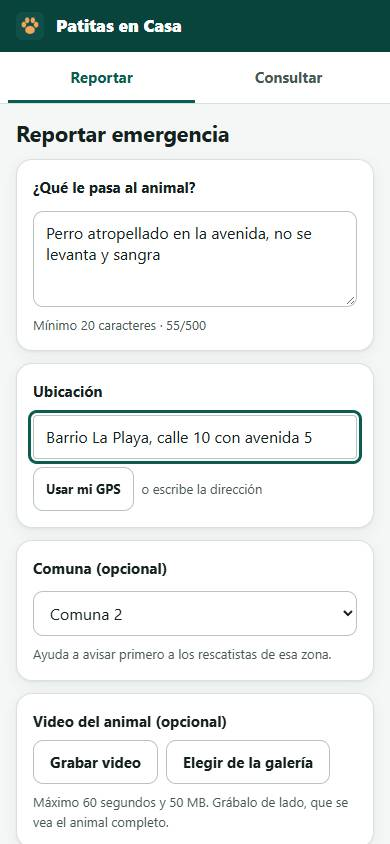
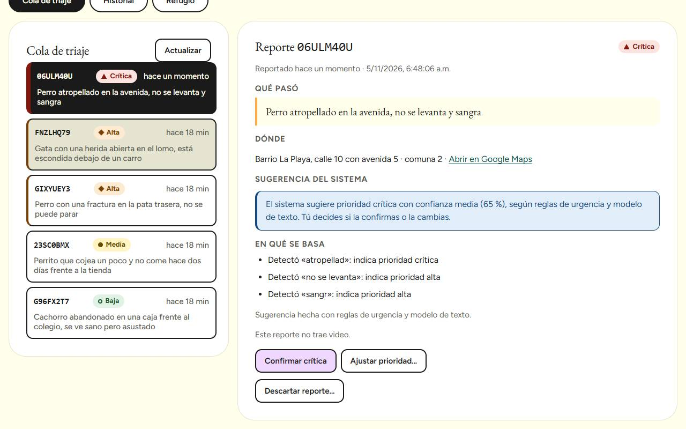
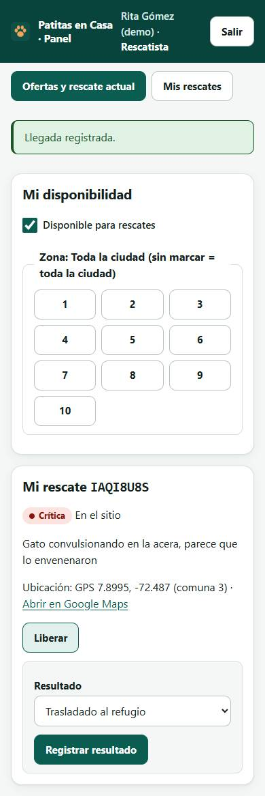
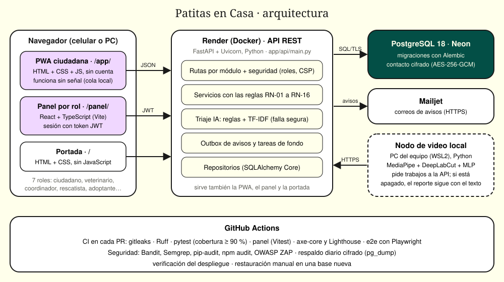

# Patitas en Casa

[](https://github.com/Brizad/patitas-en-casa/actions/workflows/ci.yml)
[](https://github.com/Brizad/patitas-en-casa/releases)

Cuando alguien en Cúcuta encuentra un perro o un gato herido, lo reporta desde el celular **sin
crear cuenta**. Una IA sugiere qué tan urgente es, un veterinario lo confirma y se avisa a los
rescatistas de la zona; el refugio controla sus cupos y da en adopción a los animales recuperados.

**En producción:** https://patitas-en-casa-pnnk.onrender.com · PWA ciudadana en
[`/app/`](https://patitas-en-casa-pnnk.onrender.com/app/) · panel por rol en
[`/panel/`](https://patitas-en-casa-pnnk.onrender.com/panel/) · API en
[`/docs`](https://patitas-en-casa-pnnk.onrender.com/docs). El plan gratis de Render se duerme sin
visitas: la primera carga puede tardar hasta un minuto.

Proyecto integrador de Ingeniería de Software II (grupo CR), Universidad de Pamplona.
Autor: Brayan David Amado Ramírez.

## Capturas

| Ciudadano: reportar (celular) | Veterinario: cola de triaje | Rescatista: rescate en curso |
|---|---|---|
|  |  |  |

Más pantallas, rol por rol: [manual de usuario](docs/manual-usuario.md).

## Arquitectura



| Pieza | Tecnología | Dónde |
|---|---|---|
| PWA ciudadana | HTML, CSS y JavaScript sin dependencias | `app/pwa/` |
| Panel por rol | React + TypeScript (Vite) | `panel/` |
| API | FastAPI (Python), SQLAlchemy Core, Alembic | `app/` |
| Triaje con IA | reglas + TF-IDF; si falla, prioridad alta y revisión manual | `app/triaje/` |
| Video (opcional) | MediaPipe + DeepLabCut en un PC del equipo | `servicios/video/` |
| Base | PostgreSQL 18 en Neon | `app/bd/esquema.py`, `migraciones/` |

Detalle en el modelo C4: [`docs/tesis/c4.md`](docs/tesis/c4.md).

## Correrlo en local (Windows)

Necesitas PostgreSQL 17 con una base `patitas`, Python 3.12 y Node.js 22.

```powershell
Copy-Item .env.example .env   # escribe tu contraseña de PostgreSQL y las claves (ver la guía)
powershell -ExecutionPolicy Bypass -File scripts\dev\arrancar_local.ps1
```

El script revisa `.env`, aplica las migraciones, compila el panel, carga los datos de
demostración y arranca la API en http://localhost:8000. Qué abrir y con qué cuentas entrar:
[`docs/aprende/desarrollo-local.md`](docs/aprende/desarrollo-local.md).

En otro sistema (o con Docker: `docker compose up --build`):

```bash
python -m venv .venv && source .venv/bin/activate
pip install -r requirements-dev.txt
cp .env.example .env              # y complétalo
alembic upgrade head
cd panel && npm ci && npm run build && cd ..
uvicorn --factory app.api.main:crear_app --reload
```

## Cómo se prueba

```bash
ruff check .                      # estilo y errores comunes
pytest --cov=app                  # unitarias y de la API; PATITAS_EXIGIR_POSTGRES=1 para no omitir las de base
cd panel && npm test              # pruebas del panel (Vitest)
```

En cada Pull Request el CI (`.github/workflows/ci.yml`) corre además: gitleaks sobre todo el
historial, pytest con PostgreSQL y **cobertura mínima del 90 %**, accesibilidad con axe-core y
Lighthouse en claro y oscuro, pruebas de punta a punta con Playwright (incluida la regresión
visual) y un escaneo de seguridad (Bandit, Semgrep, pip-audit y npm audit). Cómo correr el e2e:
[`docs/aprende/e2e.md`](docs/aprende/e2e.md).

## Documentación

| Para | Archivo |
|---|---|
| Usar el sistema | [`docs/manual-usuario.md`](docs/manual-usuario.md) |
| Estudiar el código por fases | [`docs/aprende/00-mapa.md`](docs/aprende/00-mapa.md) |
| Requisitos y su trazabilidad | [`docs/tesis/trazabilidad.md`](docs/tesis/trazabilidad.md) |
| Endpoints de la API | [`docs/tesis/catalogo-endpoints.md`](docs/tesis/catalogo-endpoints.md) |
| Seguridad (OWASP ASVS) | [`docs/tesis/seguridad.md`](docs/tesis/seguridad.md) |
| Despliegue, consumo de Neon y respaldo | [`docs/aprende/despliegue.md`](docs/aprende/despliegue.md), [`docs/aprende/respaldo.md`](docs/aprende/respaldo.md) |
| Cambios y deuda técnica | [`CHANGELOG.md`](CHANGELOG.md), [`DEUDA_TECNICA.md`](DEUDA_TECNICA.md) |

## Forma de trabajo

GitHub Flow: issue → rama corta desde `main` → pruebas primero → Pull Request de 300 líneas o
menos con el CI en verde → squash. Versiones con SemVer y etiquetas en
[Releases](https://github.com/Brizad/patitas-en-casa/releases). Tablero:
[GitHub Projects](https://github.com/users/Brizad/projects/1).
