# Manual de usuario · Patitas en Casa

Patitas en Casa ayuda a que un animal herido en Cúcuta llegue rápido a quien lo puede
atender. Este manual explica, con capturas, qué hace cada persona en el sistema.

- **Dirección:** https://patitas-en-casa-pnnk.onrender.com
- **Si la página tarda en abrir:** el servidor gratis «se duerme» cuando nadie lo usa. La
  primera vez puede tardar hasta un minuto; después va rápido.
- **Quién usa qué:**

| Persona | Dónde entra | ¿Necesita cuenta? |
|---|---|---|
| [Ciudadano](#ciudadano) | Botón «Reportar emergencia» | No |
| [Veterinario](#veterinario) | Botón «Entrar como personal» | Sí, la crea el administrador |
| [Rescatista](#rescatista) | Botón «Entrar como personal» (desde el celular) | Sí, la crea el administrador |
| [Coordinador del refugio](#coordinador-del-refugio) | Botón «Entrar como personal» | Sí, la crea el administrador |
| [Adoptante](#adoptante) | Botón «Adoptar» | Sí, la crea la misma persona |
| [Administrador](#administrador) | Botón «Entrar como personal» | Sí |
| [Alcaldía](#alcaldía) | Botón «Entrar como personal» | Sí, la crea el administrador |

Las capturas se tomaron el **25 de noviembre de 2026** con los **datos de demostración**
(nombres, reportes y animales inventados). El ciudadano, el rescatista y el adoptante se muestran
en el celular (390 px); los demás, en un computador.

**Para probarlo sin datos reales**, entra al panel con una cuenta de demostración (la contraseña
es la misma para todas y la conoce quien instaló el sistema):

| Rol | Correo |
|---|---|
| Veterinario | `veterinaria@demo.patitas.co` |
| Coordinador | `coordinador@demo.patitas.co` |
| Rescatista | `rescatista@demo.patitas.co` |
| Adoptante | `adoptante@demo.patitas.co` |
| Administrador | `admin@demo.patitas.co` |
| Alcaldía | `alcaldia@demo.patitas.co` |

**Mensajes que puedes ver en cualquier pantalla del panel:**

- «Cargando…»: los datos vienen en camino.
- «El servidor está despertando»: el servidor estaba dormido; espera unos segundos.
- «El servidor tuvo un problema, intenta de nuevo en un momento»: no es culpa de lo que
  escribiste. Espera un poco y toca **Actualizar** o repite la acción.

---

## Página de inicio

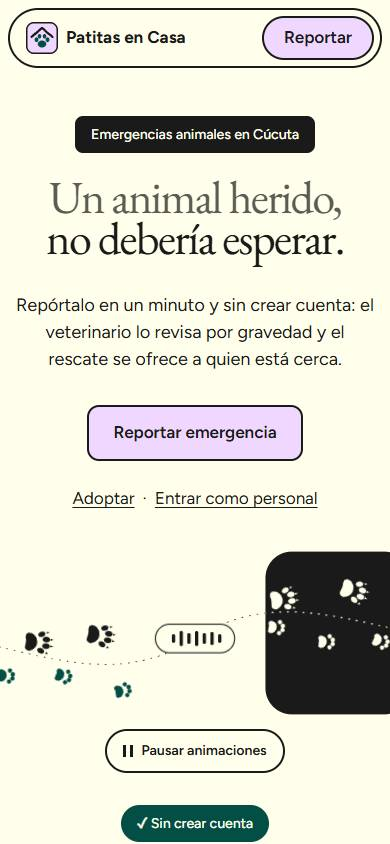

Es lo primero que se ve. Explica el proyecto en pocas líneas y tiene tres botones grandes:
**Reportar emergencia**, **Adoptar** y **Entrar como personal**. Más abajo cuenta cómo
funciona, quién hace qué y con qué tecnología está hecho.

---

## Ciudadano

Cualquier persona que encuentre un perro o un gato en peligro. **No necesita cuenta.**

### 1. Reportar

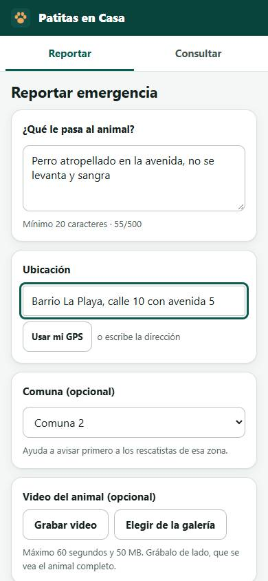

1. Toca **Reportar emergencia** en la página de inicio.
2. En **¿Qué le pasa al animal?** cuenta lo que ves, con al menos 20 letras. Por ejemplo:
   «Perro atropellado en la avenida, no se levanta y sangra». Entre más claro, mejor se
   ordena la urgencia.
3. En **Ubicación** escribe el barrio o la dirección, o toca **Usar mi GPS** (el teléfono
   te pedirá permiso).
4. Si sabes la **comuna**, elígela: así avisan primero a los rescatistas que están cerca.
5. Si puedes, agrega un **video** (máximo 60 segundos y 50 MB): toca **Grabar video** para
   grabarlo ahí mismo con la cámara de atrás, o **Elegir de la galería** si ya lo tienes.
   Grábalo de lado y que se vea el animal completo caminando: ayuda a saber si cojea o no se
   puede parar. Si no te gusta, toca **Repetir**.
6. Si quieres que te avisen, deja tu correo o teléfono y marca la autorización (es opcional y
   se guarda cifrado). Te avisaremos cuando un veterinario lo revise, cuando lo rescaten y
   cuando llegue al refugio.
7. Toca **Enviar reporte**.

Si algo falta, el formulario lo dice debajo del campo, en rojo: por ejemplo «Describe un poco
más: mínimo 20 caracteres» o «Escribe dónde está el animal o toca «Usar mi GPS»». Si escribes
letras al azar, te pedirá «Describe con palabras qué le pasa al animal».

Si no hay señal, el reporte queda guardado en el teléfono y se envía solo cuando vuelva la
conexión.

### 2. Guardar el código

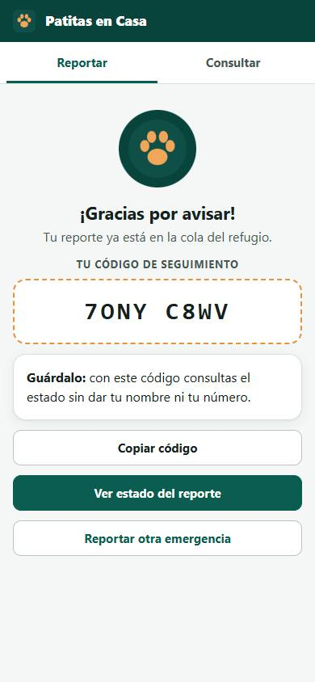

Al enviar aparece un **código de 8 letras y números**. Cópialo o tómale una foto: con él
puedes ver qué pasó con el animal.

### 3. Consultar el estado

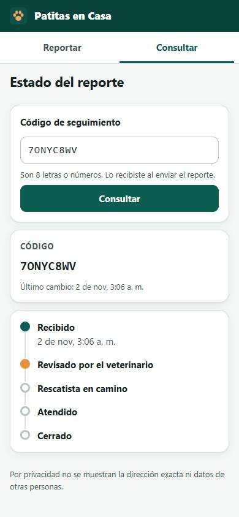

En la pestaña **Consultar** escribe tu código. Verás los pasos: recibido, revisado por el
veterinario, rescatista en camino, atendido y cerrado, con la fecha de cada uno. Por
privacidad no se muestra la dirección ni datos de otras personas.

---

## Veterinario

Revisa los reportes en orden de urgencia y decide la prioridad final. La inteligencia
artificial **sugiere**, pero **el veterinario decide**.

### 1. Cola de triaje

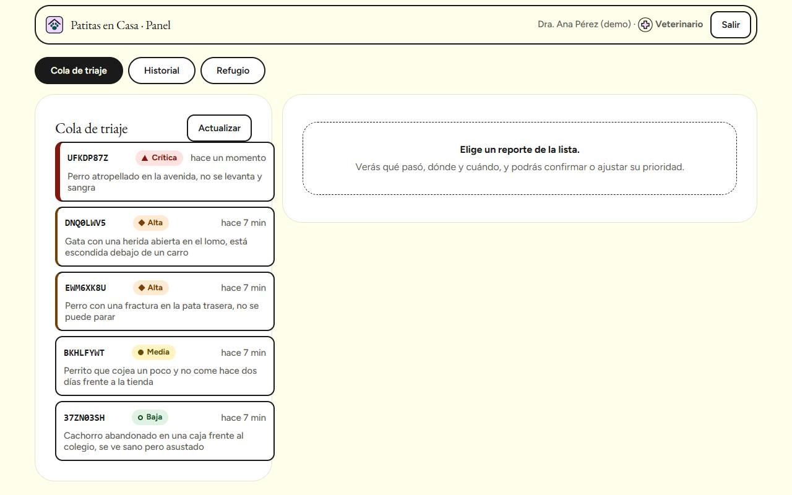

1. Entra con tu correo y contraseña en **Entrar como personal**.
2. Se abre la pestaña **Cola de triaje**.

Ahí está la **cola**: los reportes que esperan revisión, primero los más graves
(crítica, alta, media, baja). Cada prioridad se reconoce por su nombre y su forma, no solo por
el color: ▲ crítica, ◆ alta, ● media y ○ baja; las críticas y altas llevan además una barra
gruesa a la izquierda. Al lado se ve hace cuánto llegó el reporte; la confianza de la sugerencia
(de 0 a 1) aparece al abrirlo. **Actualizar** trae los reportes nuevos. Si no hay ninguno, la
pantalla dice «No hay reportes por confirmar».

### 2. Revisar un reporte

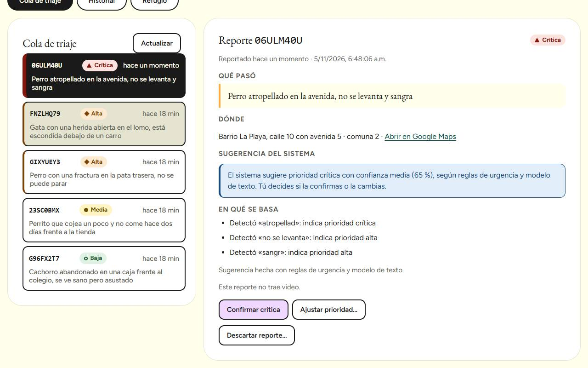

Toca un reporte de la lista. Su detalle aparece a la derecha (en el celular, debajo; la pantalla
baja sola hasta él). Mientras no elijas ninguno, en el computador dice «Elige un reporte de la
lista». El detalle muestra:

- qué pasó, dónde (con enlace a Google Maps) y hace cuánto llegó;
- la prioridad sugerida y su confianza;
- las **evidencias**: por qué la IA sugirió esa prioridad (palabras como «atropellado» o
  «sangra»); toda sugerencia crítica o alta trae al menos una;
- si hay otro reporte a menos de 200 m y 2 horas, el aviso de **posible duplicado**.

### 3. Análisis del video

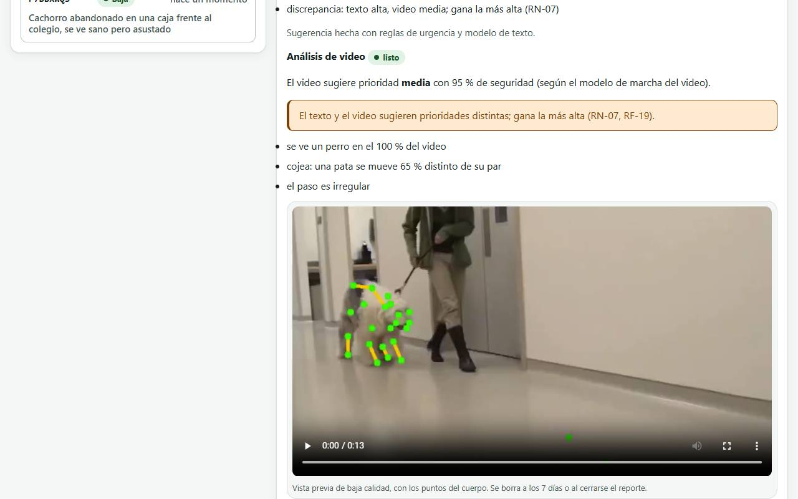

Si el ciudadano envió un video, más abajo está **Análisis de video**:

- el estado: «en espera de análisis», «analizando», «listo», «no concluyente» o «no se pudo
  analizar». Mientras se analiza, la pantalla se actualiza sola cada 15 segundos; puedes decidir
  sin esperarlo;
- la prioridad que sugiere el video, con su seguridad y las razones («cojea: una pata se mueve
  65 % distinto de su par»);
- si texto y video no coinciden, un aviso: **gana la más alta**;
- la **vista previa**: el video en baja calidad con los puntos del cuerpo dibujados. Tócalo para
  reproducirlo. Se borra a los 7 días o cuando se cierra el reporte. Si el análisis no la trae,
  la pantalla lo dice.

### 4. Confirmar, ajustar o descartar

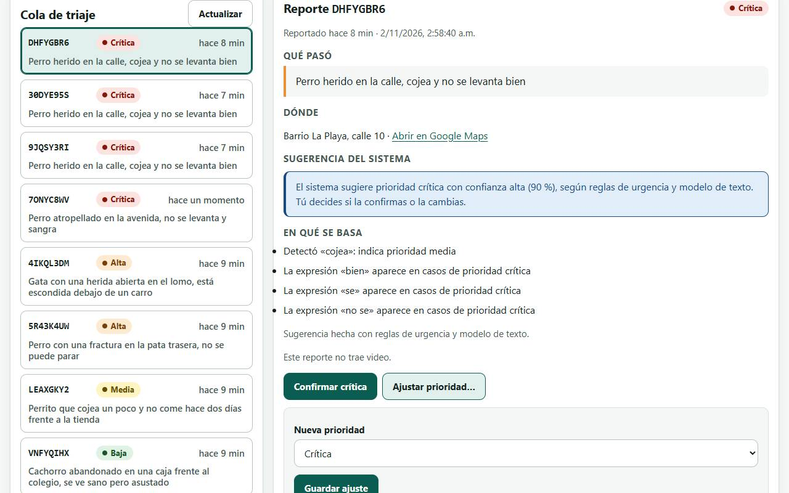

Para decidir, elige uno de los tres botones del detalle:

1. **Confirmar** (por ejemplo, «Confirmar crítica»): estás de acuerdo con la sugerencia. Listo.
2. **Ajustar prioridad…**: se abre un recuadro. Elige la **nueva prioridad** y escribe la
   **justificación** (al menos 10 caracteres y 5 letras, por ejemplo «Convulsiona: riesgo de
   muerte»). Toca **Confirmar**. Queda registrada con tu nombre.
3. **Descartar reporte…**: si es falso o repetido. Elige el motivo, escribe la justificación y
   confirma.

Confirmado o descartado, el reporte sale de la cola y no se puede volver a decidir. Si queda
crítico o alto, se avisa a los rescatistas. **Ver estado de los avisos** dice si el correo ya
salió.

### 5. Historial

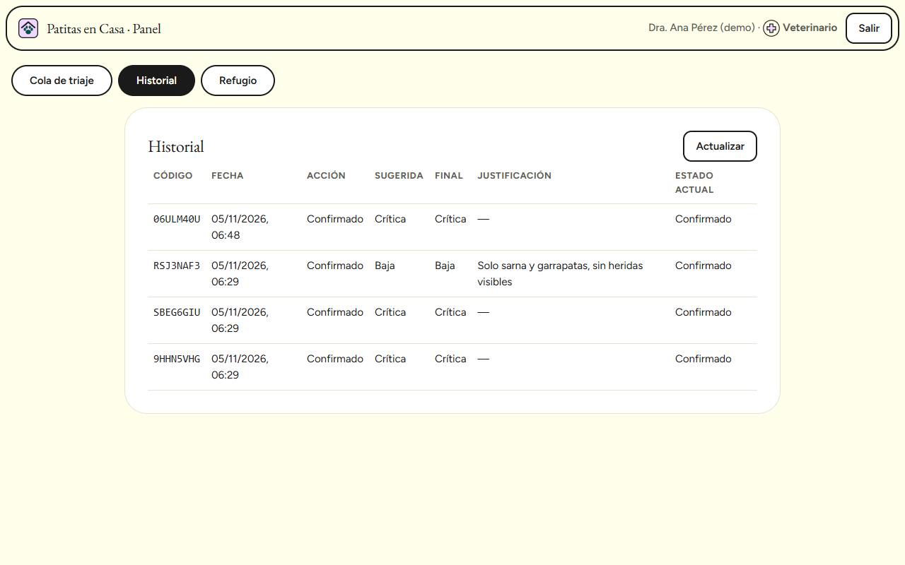

En **Historial** ve todo lo que confirmó, ajustó o descartó, del más reciente al más viejo:
código, fecha, prioridad sugerida y final, justificación y en qué va el caso ahora. En el
celular cada fila se ve como una tarjeta.

### 6. Refugio

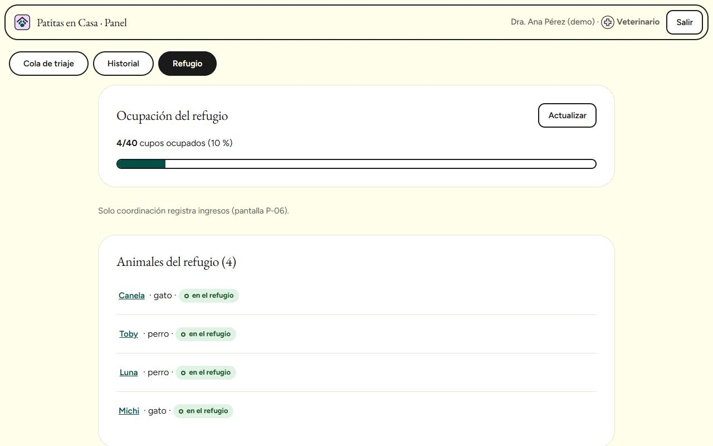

En **Refugio** ve cuántos cupos hay ocupados y los animales del refugio. Al tocar el nombre
de un animal abre su **ficha clínica**, donde puede agregar notas al historial (las notas no
se borran).

---

## Rescatista

Voluntario que va por el animal. Usa el panel **desde el celular**.

### 1. Ofertas

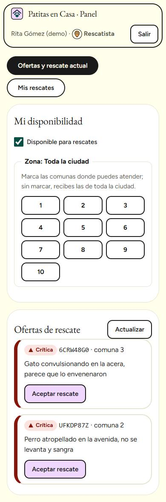

1. En **Mi disponibilidad** marca **Disponible para rescates** cuando pueda salir.
2. En **Zona** marca las comunas donde puede ir. Si no marca ninguna, recibe toda la ciudad (la
   pantalla lo recuerda debajo de «Zona»).
3. En **Ofertas de rescate** aparecen los casos críticos y altos ya confirmados por el
   veterinario, con la comuna (la dirección exacta se ve al aceptar) y la misma forma de la
   prioridad (▲ crítica, ◆ alta). Toca **Aceptar rescate**
   en el que vaya a atender. Solo una persona puede aceptar cada rescate, y cada rescatista
   atiende uno a la vez.

### 2. Rescate en curso

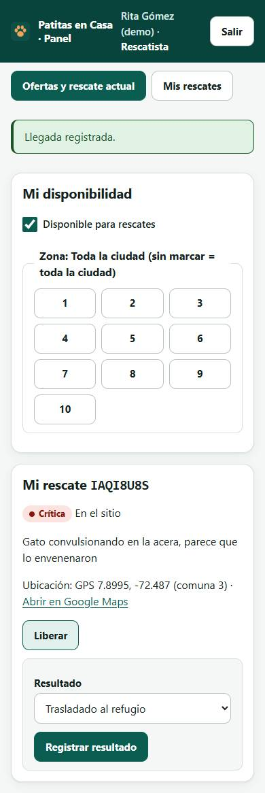

4. Ahí ve la dirección. Al llegar toca **Llegué al sitio** (queda la hora).
5. Al terminar elige el **resultado** (trasladado al refugio, atendido en el sitio, no
   encontrado o fallecido) y toca **Registrar resultado**. Si no puede seguir, **Liberar** lo
   devuelve a los demás.

Si nadie acepta un caso a tiempo (15 minutos los críticos, 30 los altos), se avisa al
coordinador y el caso se ofrece a toda la ciudad.

### 3. Mis rescates

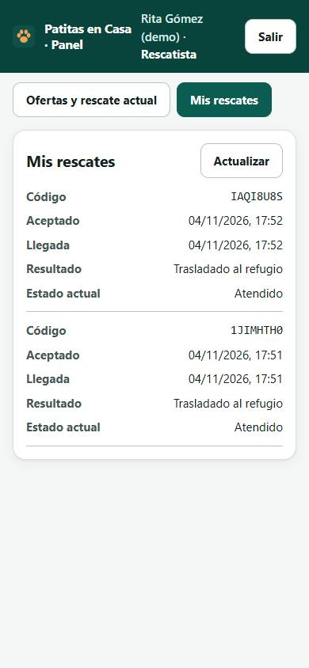

En **Mis rescates** están los rescates que aceptó, del más reciente al más viejo: código, cuándo
lo aceptó, a qué hora llegó, el resultado y cómo va el caso. No muestra la dirección.

---

## Coordinador del refugio

Maneja los cupos, los animales y las adopciones de su refugio.

### 1. Refugio: cupos e ingresos

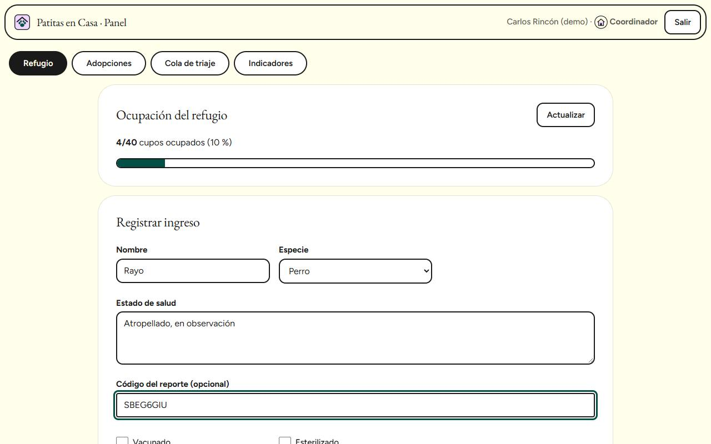

- La barra muestra cuántos cupos están ocupados. Al llegar al **90 %** el sistema avisa a
  coordinación; sin cupo, **no deja** registrar más ingresos.
- **Registrar ingreso**, paso a paso:
  1. Escribe el **nombre** y elige la **especie**.
  2. Escribe el **estado de salud** (por ejemplo, «Atropellado, en observación»).
  3. Si el animal llega de un rescate, escribe el **código del reporte** (lo ve el rescatista en
     «Mis rescates»): así el ciudadano recibe el aviso de que llegó al refugio. Si el código no
     existe, el formulario lo dice.
  4. Marca **Vacunado** o **Esterilizado** si aplica y toca **Registrar ingreso**.
- Más abajo están los animales del refugio, su ficha y el botón para registrar el **egreso**
  (adopción, traslado, fallecimiento…), que libera el cupo.

### 2. Adopciones

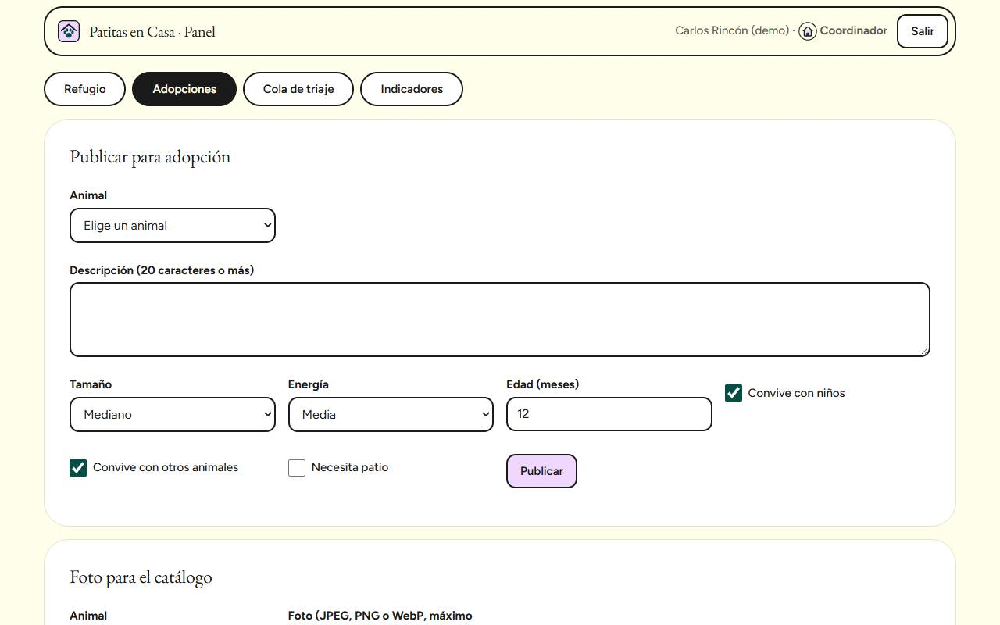

- **Publicar para adopción**: elige el animal, escribe cómo es (20 caracteres o más), su
  tamaño, energía, edad y con quién convive. Puede subir una foto.
- **Solicitudes pendientes**: aprueba o rechaza (rechazar pide una razón). El sistema no deja
  aprobar si hay una incompatibilidad grave (por ejemplo, un animal que no convive con niños
  en un hogar con niños).
- **Jornada de adopción**: propone qué animal le conviene a qué adoptante.
- **Seguimientos** a los 30, 90 y 180 días de cada adopción.

### 3. Cola e indicadores

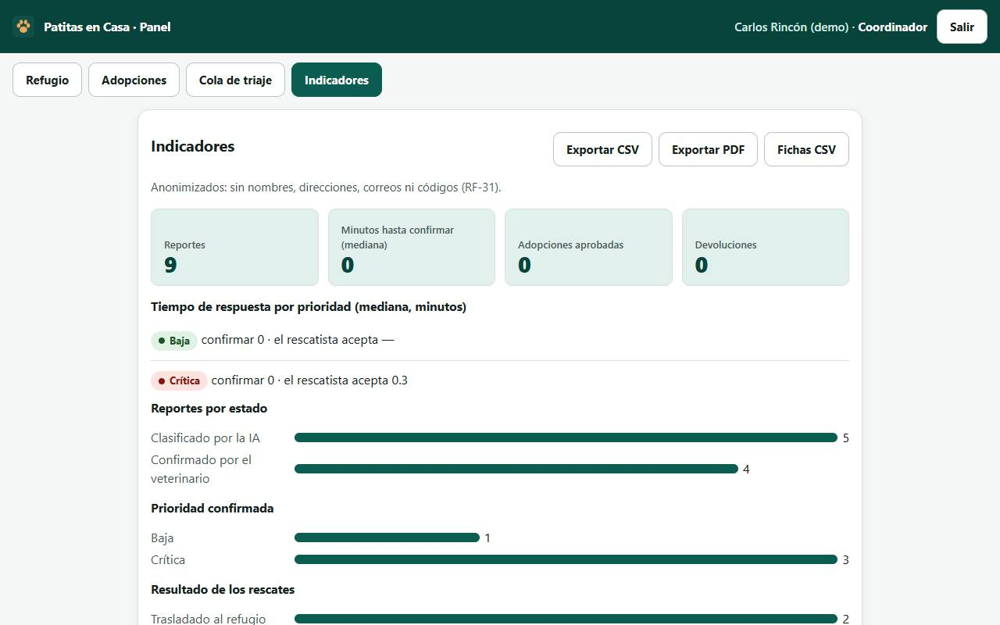

El coordinador también ve la **cola de triaje** (sin decidir prioridades) y los
**indicadores**: reportes, tiempos de respuesta, rescates y adopciones. Puede exportarlos a
CSV o PDF, siempre **sin datos personales**.

---

## Adoptante

Persona que quiere adoptar. Crea su propia cuenta.

### 1. Crear la cuenta

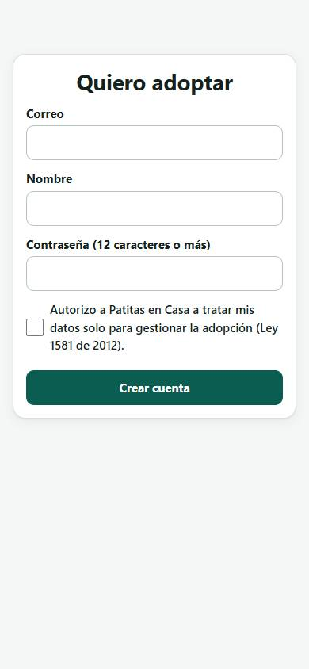

1. En la página de inicio toca **Adoptar**.
2. Escribe tu correo, tu nombre y una contraseña de **12 caracteres o más**.
3. Marca la casilla que autoriza el uso de tus datos solo para la adopción (Ley 1581 de
   2012). Sin esa autorización no se puede crear la cuenta.
4. Toca **Crear cuenta** y luego entra con tu correo y contraseña.

### 2. Tu perfil y los animales recomendados

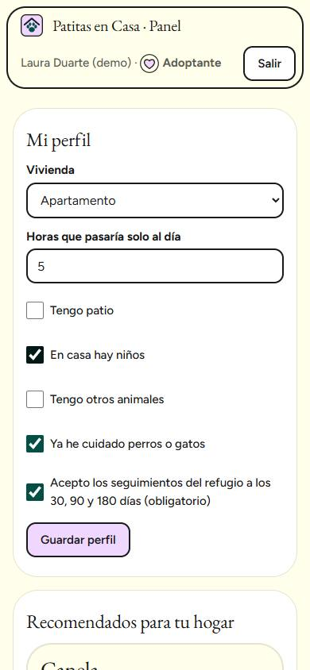

- Llena **Mi perfil**: tipo de vivienda, horas que el animal estaría solo, si hay patio,
  niños u otros animales y si ya has cuidado mascotas. Debes aceptar los **seguimientos** del
  refugio (a los 30, 90 y 180 días). El perfil se guarda **cifrado**.
- En **Recomendados para tu hogar** verás los animales que mejor encajan, con las razones.
- Toca **Quiero adoptarlo** en el que te guste; el refugio revisará la solicitud. En **Mis solicitudes** ves si la
  aprobaron; si sí, puedes descargar el **compromiso de adopción** en PDF.

---

## Administrador

Crea las cuentas del personal y los refugios, y revisa la bitácora.

### 1. Cuentas y refugios

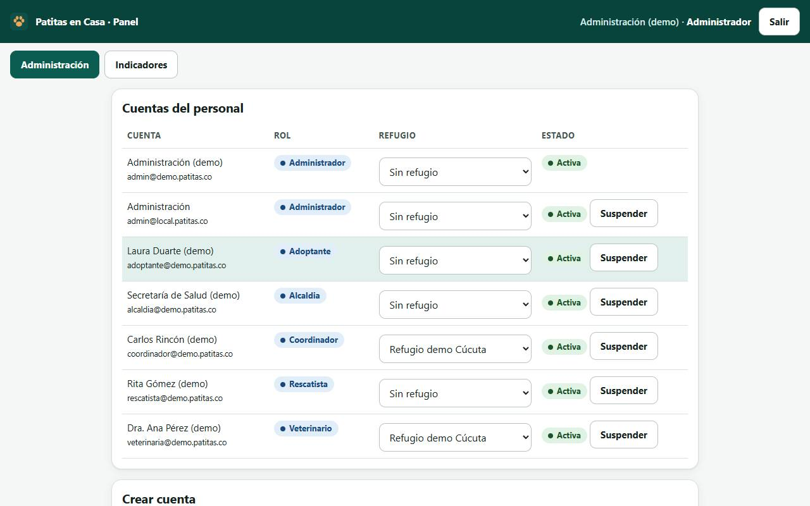

- **Cuentas del personal**: muestra cada cuenta con su rol. Desde aquí se **vincula** a un
  refugio y se **suspende** o reactiva (una cuenta suspendida pierde el acceso enseguida).
- **Crear cuenta**: correo, nombre, rol (veterinario, coordinador, rescatista, alcaldía o
  administrador) y una contraseña inicial de 12 caracteres o más.
- **Refugios**: registrar un refugio nuevo con su capacidad.

### 2. Bitácora

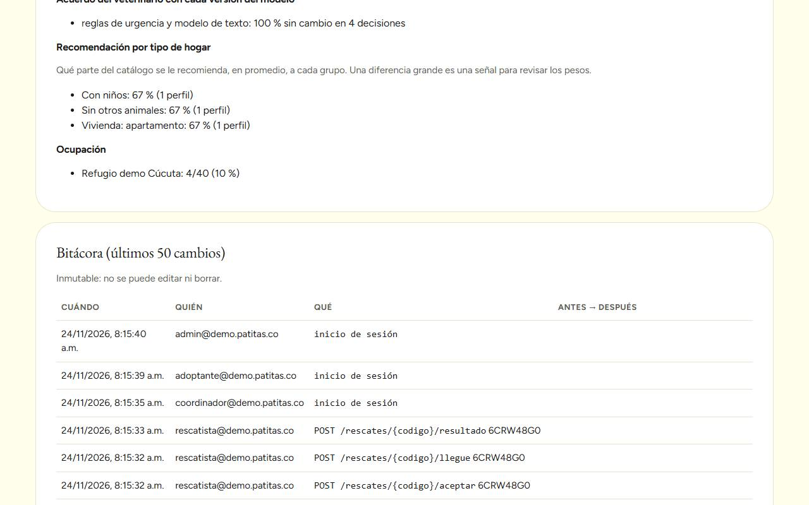

En **Indicadores**, al final, está la **bitácora**: quién hizo cada cambio, cuándo, sobre qué
y cómo estaba **antes → después** (por ejemplo, «prioridad: media → alta»). No se puede
editar ni borrar. Tampoco guarda contraseñas ni datos personales.

### 3. Modo piloto

Sirve para la prueba de usabilidad con personas reales sin que sus reportes lleguen a la cola.

1. En la pestaña **Modo piloto**, toca **Nuevo participante** en el celular de la prueba.
2. Se abre la app en modo prueba: la persona reporta como lo haría un ciudadano. El tiempo se
   mide desde su primer toque hasta que ve el código. Nada llega a la cola ni a los rescatistas.
3. Al final responde el cuestionario corto (SUS).
4. **Descargar CSV** se habilita cuando al menos un participante termina; trae los resultados.

---

## Alcaldía

La Secretaría de Salud (u otra dependencia) solo **consulta**.

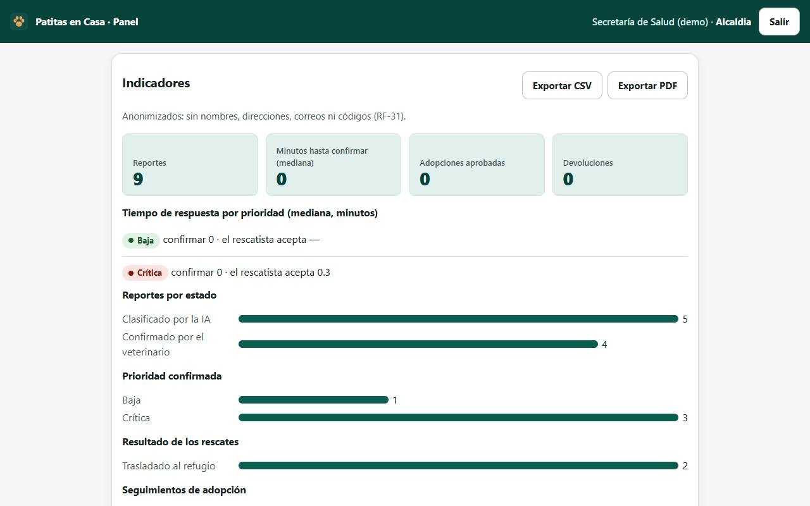

Ve los **indicadores anonimizados** de la ciudad: cuántos reportes hay, cuánto se tarda en
atenderlos, en qué terminan los rescates y cómo van las adopciones. Puede exportarlos a CSV o
PDF. No ve nombres, direcciones, correos ni códigos.

---

## Preguntas frecuentes

- **Olvidé el código de mi reporte.** Por privacidad no se puede buscar de otra forma. Si
  dejaste tu correo, los avisos (revisado, rescatado, en el refugio) traen el código.
- **Mandé muchos reportes y me dice que espere.** Desde una misma conexión se reciben hasta
  20 reportes cada 15 minutos. Si es una emergencia, espera los minutos que indica y vuelve a
  enviarlo.
- **Me dice «Demasiados intentos».** Por seguridad, después de varios intentos fallidos hay
  que esperar unos minutos. El mensaje dice cuánto.
- **No veo una pestaña que otra persona sí ve.** Cada rol ve solo lo suyo. Si te falta algo
  que necesitas, habla con el administrador.
- **Dice «El servidor tuvo un problema».** El servidor falló o se estaba reiniciando; lo que
  escribiste no tiene la culpa. Espera un momento y vuelve a intentarlo.
- **¿La IA decide sola?** No. Sugiere una prioridad con sus razones; el veterinario la
  confirma o la cambia. Si la IA duda o falla, el caso se trata como urgente y lo revisa una
  persona.

## Para quien mantiene el sistema

Las capturas se toman solas con los datos de demostración, sin tocar la base real. Las del 25 de
noviembre salieron del sistema local (`scripts/dev/arrancar_local.ps1`, ver
`docs/aprende/desarrollo-local.md`) sobre una base de **prueba**:

```powershell
cd scripts\accesibilidad
npm ci
$env:PATITAS_DEMO_CONTRASENA = "<la de tu .env>"; $env:A11Y_CANAL = "msedge"
node capturas.mjs http://127.0.0.1:8000
```

La captura del análisis de video (`06c-veterinario-video.jpg`) solo se retoma con el trabajador
de video encendido y un reporte con video analizado; se conserva la del 5 de noviembre. El script acepta un rescate y registra un
resultado: úsalo solo en una base de prueba.
