# Manual de usuario · Patitas en Casa

Patitas en Casa ayuda a que un animal herido en Cúcuta llegue rápido a quien lo puede
atender. Este manual explica, con capturas, qué hace cada persona en el sistema.

- **Dirección:** https://patitas-en-casa-pnnk.onrender.com
- **Si la página tarda en abrir:** el servidor gratis «se duerme» cuando nadie lo usa. La
  primera vez puede tardar hasta un minuto; después va rápido.
- **Quién usa qué:**

| Persona | Dónde entra | ¿Necesita cuenta? |
|---|---|---|
| [Ciudadano](#ciudadano) | Botón «Reportar emergencia» | No |
| [Veterinario](#veterinario) | Botón «Entrar como personal» | Sí, la crea el administrador |
| [Rescatista](#rescatista) | Botón «Entrar como personal» (desde el celular) | Sí, la crea el administrador |
| [Coordinador del refugio](#coordinador-del-refugio) | Botón «Entrar como personal» | Sí, la crea el administrador |
| [Adoptante](#adoptante) | Botón «Adoptar» | Sí, la crea la misma persona |
| [Administrador](#administrador) | Botón «Entrar como personal» | Sí |
| [Alcaldía](#alcaldía) | Botón «Entrar como personal» | Sí, la crea el administrador |

Las capturas se tomaron con los **datos de demostración** (nombres, reportes y animales
inventados).

---

## Página de inicio

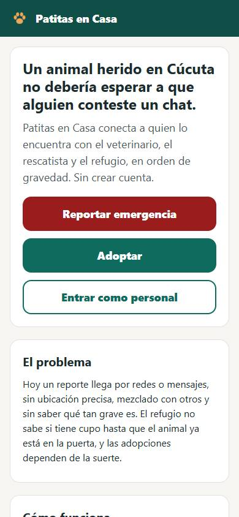

Es lo primero que se ve. Explica el proyecto en pocas líneas y tiene tres botones grandes:
**Reportar emergencia**, **Adoptar** y **Entrar como personal**. Más abajo cuenta cómo
funciona, quién hace qué y con qué tecnología está hecho.

---

## Ciudadano

Cualquier persona que encuentre un perro o un gato en peligro. **No necesita cuenta.**

### 1. Reportar

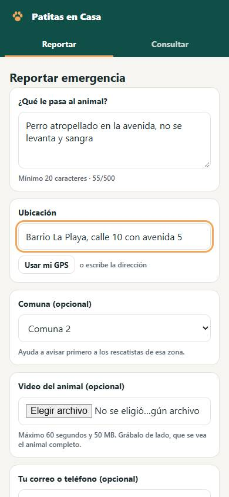

1. Toca **Reportar emergencia** en la página de inicio.
2. En **¿Qué le pasa al animal?** cuenta lo que ves, con al menos 20 letras. Por ejemplo:
   «Perro atropellado en la avenida, no se levanta y sangra». Entre más claro, mejor se
   ordena la urgencia.
3. En **Ubicación** escribe el barrio o la dirección, o toca **Usar mi GPS** (el teléfono
   te pedirá permiso).
4. Si sabes la **comuna**, elígela: así avisan primero a los rescatistas que están cerca.
5. Si puedes, adjunta un **video** corto (máximo 60 segundos). Grábalo de lado y que se vea
   el animal completo caminando: ayuda a saber si cojea o no se puede parar.
6. Si quieres que te avisen, deja tu correo o teléfono (es opcional y se guarda cifrado).
7. Toca **Enviar reporte**.

Si no hay señal, el reporte queda guardado en el teléfono y se envía solo cuando vuelva la
conexión.

### 2. Guardar el código

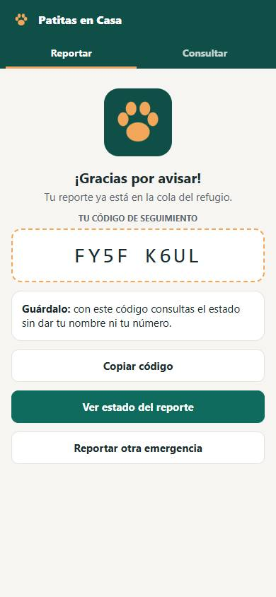

Al enviar aparece un **código de 8 letras y números**. Cópialo o tómale una foto: con él
puedes ver qué pasó con el animal.

### 3. Consultar el estado

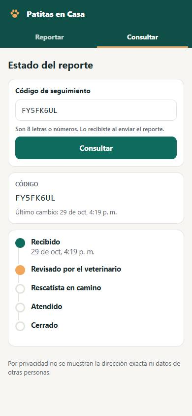

En la pestaña **Consultar** escribe tu código. Verás los pasos: recibido, revisado por el
veterinario, rescatista en camino, atendido y cerrado, con la fecha de cada uno. Por
privacidad no se muestra la dirección ni datos de otras personas.

---

## Veterinario

Revisa los reportes en orden de urgencia y decide la prioridad final. La inteligencia
artificial **sugiere**, pero **el veterinario decide**.

### 1. Cola de triaje

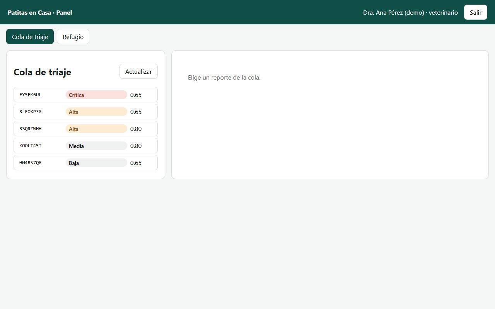

Al entrar ve la **cola**: los reportes que esperan revisión, primero los más graves
(crítica, alta, media, baja). El número al lado es la confianza de la sugerencia (de 0 a 1).
**Actualizar** trae los reportes nuevos.

### 2. Revisar un reporte

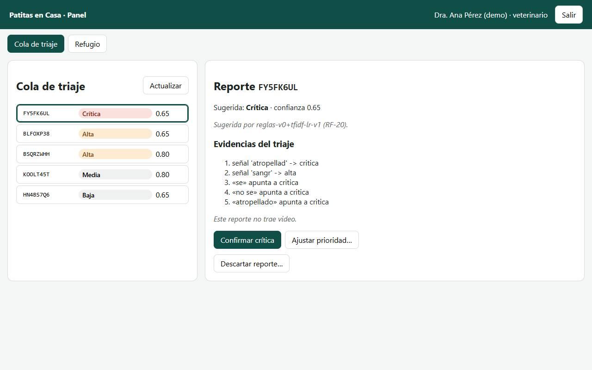

Al tocar un reporte aparece a la derecha:

- la prioridad sugerida y su confianza;
- las **evidencias**: por qué la IA sugirió esa prioridad (palabras como «atropellado» o
  «sangra»);
- el análisis del **video**, si el ciudadano envió uno.

Después elige una de tres acciones:

- **Confirmar**: está de acuerdo con la sugerencia.
- **Ajustar prioridad…**: la cambia (ver abajo).
- **Descartar reporte…**: si es falso o repetido, con una justificación.

Confirmado o descartado, el reporte sale de la cola y no se puede volver a decidir. Si
queda crítico o alto, se avisa a los rescatistas.

### 3. Ajustar la prioridad

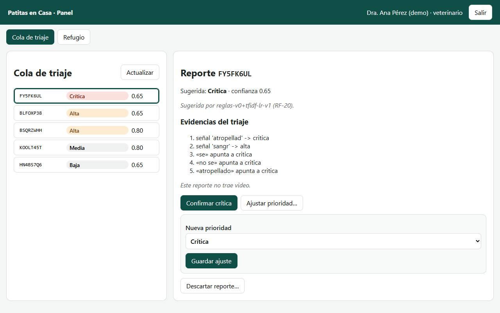

Elige la nueva prioridad. Si es distinta de la sugerida, el sistema pide una
**justificación** (al menos 10 caracteres y 5 letras). Queda registrada con su nombre.

### 4. Refugio

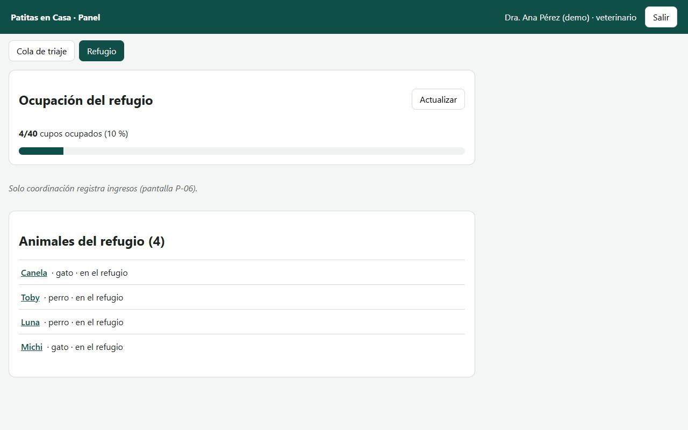

En **Refugio** ve cuántos cupos hay ocupados y los animales del refugio. Al tocar el nombre
de un animal abre su **ficha clínica**, donde puede agregar notas al historial (las notas no
se borran).

---

## Rescatista

Voluntario que va por el animal. Usa el panel **desde el celular**.

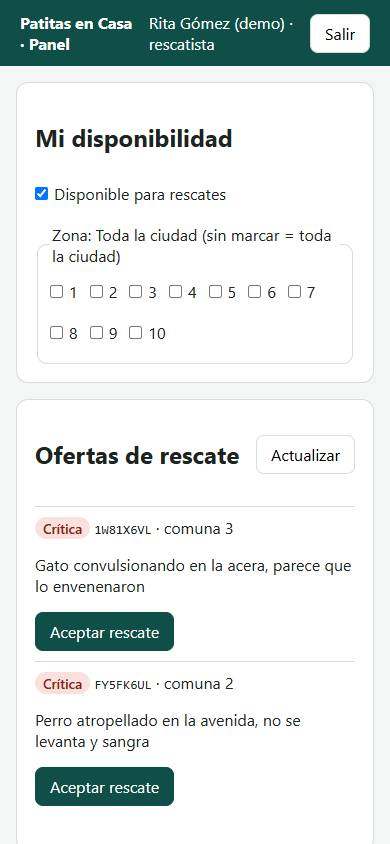

1. En **Mi disponibilidad** marca **Disponible para rescates** cuando pueda salir.
2. En **Zona** marca las comunas donde puede ir. Si no marca ninguna, recibe toda la ciudad.
3. En **Ofertas de rescate** aparecen los casos críticos y altos ya confirmados por el
   veterinario. Toca **Aceptar rescate** en el que vaya a atender. Solo una persona puede
   aceptar cada rescate, y cada rescatista atiende uno a la vez.
4. Al llegar toca **Llegué al sitio**; al terminar registra el **resultado** (por ejemplo, trasladado
   al refugio). Si no puede seguir, **Liberar** lo devuelve a los demás.

Si nadie acepta un caso a tiempo (15 minutos los críticos), se avisa al coordinador y el
caso se ofrece a toda la ciudad.

---

## Coordinador del refugio

Maneja los cupos, los animales y las adopciones de su refugio.

### 1. Refugio: cupos e ingresos

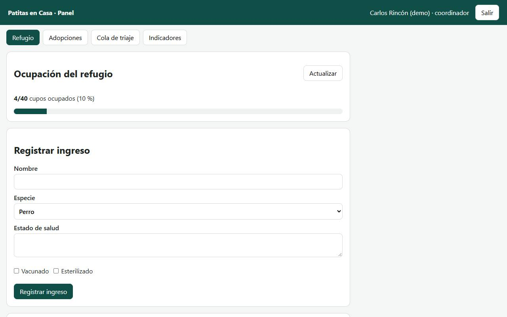

- La barra muestra cuántos cupos están ocupados. Al llegar al **90 %** el sistema avisa a
  coordinación; sin cupo, **no deja** registrar más ingresos.
- **Registrar ingreso**: nombre, especie, estado de salud y si está vacunado o
  esterilizado. Más abajo están los animales del refugio, su ficha y el botón para registrar
  el **egreso** (adopción, traslado, fallecimiento…), que libera el cupo.

### 2. Adopciones

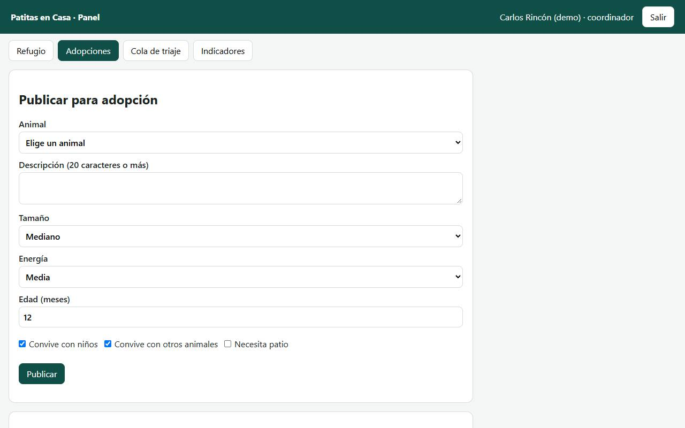

- **Publicar para adopción**: elige el animal, escribe cómo es (20 caracteres o más), su
  tamaño, energía, edad y con quién convive. Puede subir una foto.
- **Solicitudes pendientes**: aprueba o rechaza (rechazar pide una razón). El sistema no deja
  aprobar si hay una incompatibilidad grave (por ejemplo, un animal que no convive con niños
  en un hogar con niños).
- **Jornada de adopción**: propone qué animal le conviene a qué adoptante.
- **Seguimientos** a los 30, 90 y 180 días de cada adopción.

### 3. Cola e indicadores

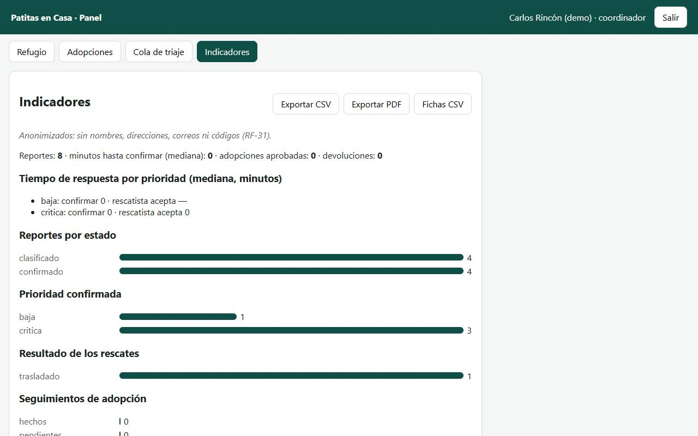

El coordinador también ve la **cola de triaje** (sin decidir prioridades) y los
**indicadores**: reportes, tiempos de respuesta, rescates y adopciones. Puede exportarlos a
CSV o PDF, siempre **sin datos personales**.

---

## Adoptante

Persona que quiere adoptar. Crea su propia cuenta.

### 1. Crear la cuenta

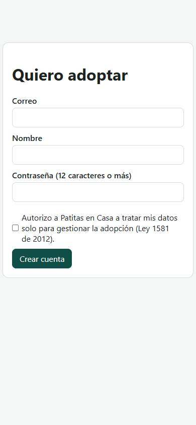

1. En la página de inicio toca **Adoptar**.
2. Escribe tu correo, tu nombre y una contraseña de **12 caracteres o más**.
3. Marca la casilla que autoriza el uso de tus datos solo para la adopción (Ley 1581 de
   2012). Sin esa autorización no se puede crear la cuenta.
4. Toca **Crear cuenta** y luego entra con tu correo y contraseña.

### 2. Tu perfil y los animales recomendados

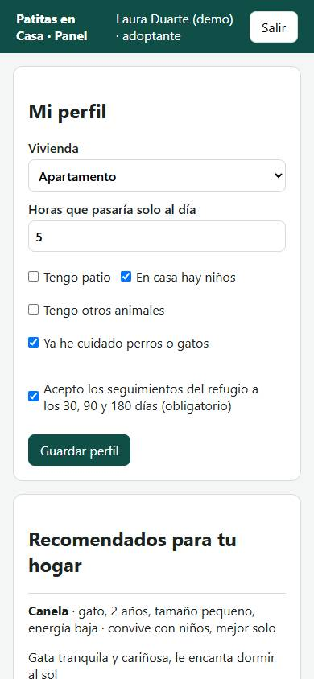

- Llena **Mi perfil**: tipo de vivienda, horas que el animal estaría solo, si hay patio,
  niños u otros animales y si ya has cuidado mascotas. Debes aceptar los **seguimientos** del
  refugio (a los 30, 90 y 180 días). El perfil se guarda **cifrado**.
- En **Recomendados para tu hogar** verás los animales que mejor encajan, con las razones.
- Toca **Quiero adoptarlo** en el que te guste; el refugio revisará la solicitud. En **Mis solicitudes** ves si la
  aprobaron; si sí, puedes descargar el **compromiso de adopción** en PDF.

---

## Administrador

Crea las cuentas del personal y los refugios, y revisa la bitácora.

### 1. Cuentas y refugios

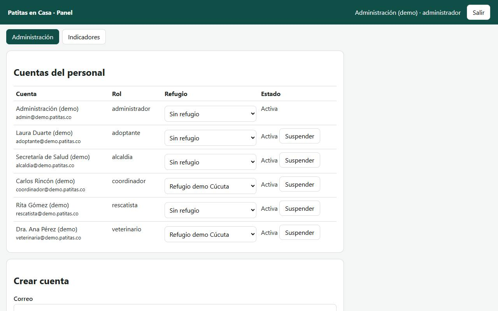

- **Cuentas del personal**: muestra cada cuenta con su rol. Desde aquí se **vincula** a un
  refugio y se **suspende** o reactiva (una cuenta suspendida pierde el acceso enseguida).
- **Crear cuenta**: correo, nombre, rol (veterinario, coordinador, rescatista, alcaldía o
  administrador) y una contraseña inicial de 12 caracteres o más.
- **Refugios**: registrar un refugio nuevo con su capacidad.

### 2. Bitácora

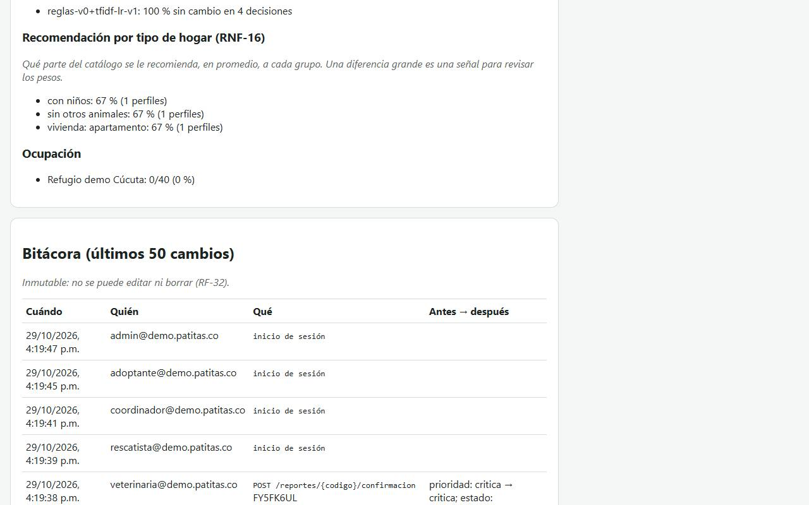

En **Indicadores**, al final, está la **bitácora**: quién hizo cada cambio, cuándo, sobre qué
y cómo estaba **antes → después** (por ejemplo, «prioridad: media → alta»). No se puede
editar ni borrar. Tampoco guarda contraseñas ni datos personales.

---

## Alcaldía

La Secretaría de Salud (u otra dependencia) solo **consulta**.

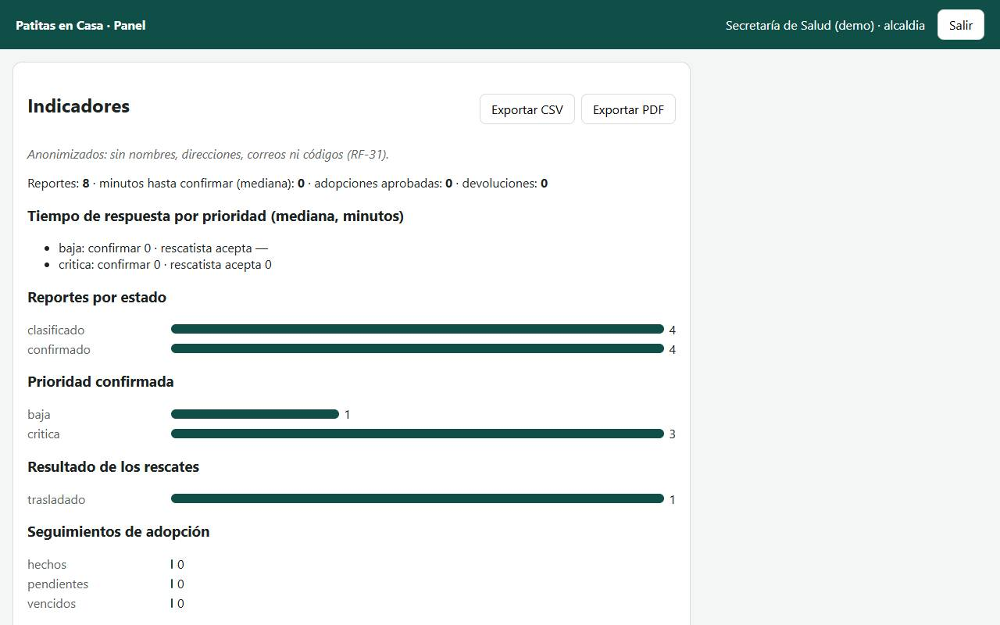

Ve los **indicadores anonimizados** de la ciudad: cuántos reportes hay, cuánto se tarda en
atenderlos, en qué terminan los rescates y cómo van las adopciones. Puede exportarlos a CSV o
PDF. No ve nombres, direcciones, correos ni códigos.

---

## Preguntas frecuentes

- **Olvidé el código de mi reporte.** Por privacidad no se puede buscar de otra forma. Si
  dejaste tu correo, el aviso de que un veterinario revisó tu reporte trae el código.
- **Me dice «Demasiados intentos».** Por seguridad, después de varios intentos fallidos hay
  que esperar unos minutos. El mensaje dice cuánto.
- **No veo una pestaña que otra persona sí ve.** Cada rol ve solo lo suyo. Si te falta algo
  que necesitas, habla con el administrador.
- **¿La IA decide sola?** No. Sugiere una prioridad con sus razones; el veterinario la
  confirma o la cambia. Si la IA duda o falla, el caso se trata como urgente y lo revisa una
  persona.

## Para quien mantiene el sistema

Las capturas se toman solas con los datos de demostración, sin tocar la base real:

```bash
cd scripts/accesibilidad
npm ci
```
```bash
python servidor_demo.py 8765
```
```bash
node capturas.mjs
```

(Las dos últimas en terminales distintas, con la misma `PATITAS_DEMO_CONTRASENA` inventada en
las dos; en Windows con Edge, agrega `A11Y_CANAL=msedge`.)
