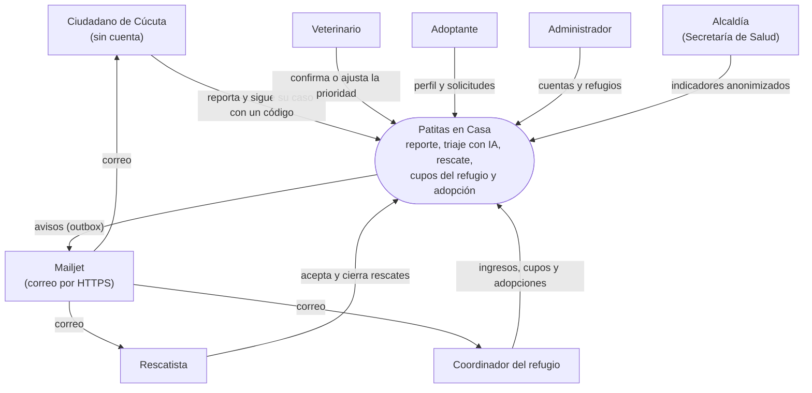
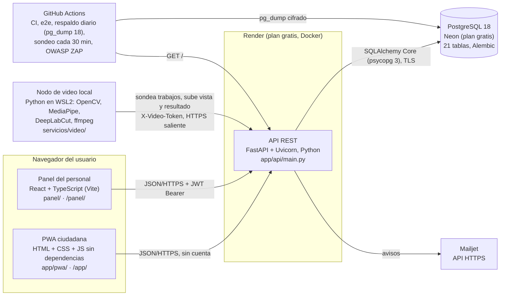
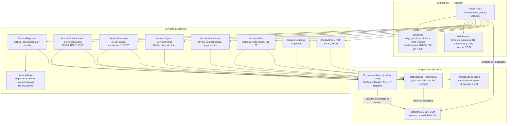

# Arquitectura en el modelo C4

Tres niveles del modelo C4 (Simon Brown): contexto, contenedores y componentes de la API. Cada
caja nombra el archivo o la clase real; nada de lo que aparece aquí es un plan a futuro.
Estado al 4 de noviembre de 2026 (`main`, versión 1.2.0 más los cambios sin publicar del
`CHANGELOG.md`).

## Nivel 1: contexto

## Nivel 2: contenedores

Notas que se ven en el código:
- La API sirve también la PWA, el panel compilado y la página de inicio (`StaticFiles` en
  `crear_app`), con la misma CSP estricta (`POLITICA_PWA`).
- El nodo de video **no recibe conexiones**: llama a la API desde la casa del equipo
  (`servicios/video/patitas_video/cliente.py`). Si está apagado, el reporte sigue con el texto.
- El video original nunca se guarda: espera en PostgreSQL por trozos y se borra al terminar el
  análisis (`app/video/almacen.py`, RNF-08); la vista previa del veterinario se borra a los
  7 días o al cerrarse el reporte (#214).

## Nivel 3: componentes de la API

Tareas en segundo plano que arranca `crear_app` (cada una con su intervalo en `app/config.py`):
revisión de escalamientos (`ServicioRescates.escalar_vencidos`), envío de avisos pendientes
(`ProcesadorAvisos`) y revisión de videos vencidos y vistas previas viejas
(`ServicioVideo.revisar`).

Cada servicio recibe sus repositorios por el constructor (puertos `Protocol`): por eso las
mismas reglas se prueban en memoria (rápido, sin base) y contra PostgreSQL (marcador
`postgres`), con las mismas pruebas de contrato.
