<!-- Archivo generado por scripts/tesis/generar_docs.py: no se edita a mano. -->

# Modelo entidad-relación

Tablas de `app/bd/esquema.py` (PostgreSQL 18 en Neon; 17 en local y en el CI). PK = clave primaria, FK = clave foránea, UK = única.

```mermaid
erDiagram
  bitacora {
    bigint id PK
    timestamp_with_time_zone momento
    text actor
    text accion
    jsonb objeto
    smallint estado_http
    jsonb valor_anterior
    jsonb valor_nuevo
  }
  intentos_fallidos {
    integer id PK
    text clave
    timestamp_with_time_zone ocurrido_en
  }
  piloto {
    varchar codigo PK
    varchar token_hash UK
    timestamp_with_time_zone creado_en
    timestamp_with_time_zone vence_en
    timestamp_with_time_zone reporte_en
    integer segundos
    smallint_ sus
    timestamp_with_time_zone respondido_en
  }
  refugios {
    integer id PK
    text nombre
    integer capacidad
    integer ocupados
    text direccion
  }
  reportes {
    varchar codigo PK
    text descripcion
    double_precision latitud
    double_precision longitud
    text direccion
    integer video_segundos
    varchar estado
    varchar prioridad
    double_precision confianza
    jsonb evidencias
    timestamp_with_time_zone creado_en
    smallint comuna
    varchar clave_idempotencia UK
    varchar version_modelo
    text contacto_cifrado
  }
  rescatistas {
    text correo PK
    boolean disponible
    timestamp_with_time_zone actualizado_en
    smallint_ comunas
  }
  videos_trozos {
    varchar ruta PK
    integer orden PK
    bytea datos
    timestamp_with_time_zone creado_en
  }
  vistas_trozos {
    varchar ruta PK
    integer orden PK
    bytea datos
    timestamp_with_time_zone creado_en
  }
  analisis_video {
    integer id PK
    varchar codigo FK,UK
    text ruta
    bigint bytes
    varchar estado
    smallint intentos
    timestamp_with_time_zone creado_en
    timestamp_with_time_zone reclamado_en
    timestamp_with_time_zone terminado_en
    varchar prioridad
    double_precision confianza
    jsonb evidencias
    jsonb medidas
    varchar version_modelo
    text motivo
    boolean discrepancia
    bytea tira
    varchar vista_ruta
    integer vista_bytes
    timestamp_with_time_zone vista_en
  }
  animales {
    integer id PK
    integer refugio_id FK
    text nombre
    varchar especie
    text estado_salud
    boolean vacunado
    boolean esterilizado
    timestamp_with_time_zone ingresado_en
    timestamp_with_time_zone egresado_en
    varchar motivo_egreso
  }
  avisos {
    integer id PK
    varchar reporte_codigo FK
    text destinatario
    text mensaje
    varchar estado
    integer intentos
    text ultimo_error
    timestamp_with_time_zone creado_en
    timestamp_with_time_zone proximo_intento_en
    timestamp_with_time_zone reclamado_en
    timestamp_with_time_zone enviado_en
  }
  decisiones_triaje {
    integer id PK
    varchar reporte_codigo FK
    text veterinario
    varchar prioridad_sugerida
    varchar prioridad_final
    text justificacion
    timestamp_with_time_zone decidido_en
    varchar version_modelo
  }
  descartes {
    varchar reporte_codigo PK,FK
    text veterinario
    varchar motivo
    varchar duplicado_de FK
    text justificacion
    timestamp_with_time_zone descartado_en
  }
  escalamientos {
    varchar reporte_codigo PK,FK
    timestamp_with_time_zone escalado_en
  }
  fotos_evidencia {
    integer id PK
    varchar reporte_codigo FK
    varchar origen
    varchar tipo
    bytea datos
    timestamp_with_time_zone creada_en
  }
  informes_rescate {
    varchar reporte_codigo PK,FK
    text rescatista
    varchar encontrado
    varchar estados
    varchar resultado
    text motivo
    text nota
    timestamp_with_time_zone creado_en
  }
  rescates {
    integer id PK
    varchar reporte_codigo FK
    text rescatista
    varchar estado
    varchar resultado
    timestamp_with_time_zone aceptado_en
    timestamp_with_time_zone actualizado_en
    timestamp_with_time_zone llegada_en
  }
  ubicaciones_rescate {
    varchar reporte_codigo PK,FK
    double_precision latitud
    double_precision longitud
    boolean simulada
    timestamp_with_time_zone actualizada_en
  }
  usuarios {
    integer id PK
    text correo
    text nombre
    varchar rol
    text hash_contrasena
    boolean activo
    timestamp_with_time_zone creado_en
    integer refugio_id FK
  }
  fotos_animales {
    integer animal_id PK,FK
    varchar tipo
    bytea datos
    timestamp_with_time_zone guardada_en
  }
  historial_clinico {
    integer id PK
    integer animal_id FK
    text autor
    varchar tipo
    text texto
    timestamp_with_time_zone registrada_en
  }
  perfiles_adoptante {
    text correo PK,FK
    varchar vivienda
    boolean tiene_patio
    boolean hay_ninos
    boolean otros_animales
    smallint horas_solo_al_dia
    boolean experiencia
    boolean acepta_seguimiento
    timestamp_with_time_zone actualizado_en
    text datos_cifrados
  }
  publicaciones {
    integer animal_id PK,FK
    text descripcion
    varchar tamano
    varchar energia
    smallint edad_meses
    boolean apto_ninos
    boolean apto_otros_animales
    boolean necesita_patio
    varchar estado
    timestamp_with_time_zone publicado_en
    smallint carino
    smallint energia_nivel
    smallint juego
    smallint calma
    varchar etiquetas
    numeric peso_kg
    numeric peso_adulto_kg
  }
  solicitudes {
    integer id PK
    integer animal_id FK
    text adoptante FK
    text mensaje
    varchar estado
    timestamp_with_time_zone creada_en
    text decidida_por
    timestamp_with_time_zone decidida_en
    text razon
  }
  seguimientos {
    integer id PK
    integer solicitud_id FK
    smallint dia
    timestamp_with_time_zone programado_para
    timestamp_with_time_zone realizado_en
    text nota
    text registrado_por
  }
  reportes ||--o| analisis_video : "codigo"
  refugios ||--o{ animales : "refugio_id"
  reportes ||--o{ avisos : "reporte_codigo"
  reportes ||--o{ decisiones_triaje : "reporte_codigo"
  reportes ||--o{ descartes : "duplicado_de"
  reportes ||--o| descartes : "reporte_codigo"
  reportes ||--o| escalamientos : "reporte_codigo"
  reportes ||--o{ fotos_evidencia : "reporte_codigo"
  reportes ||--o| informes_rescate : "reporte_codigo"
  reportes ||--o{ rescates : "reporte_codigo"
  reportes ||--o| ubicaciones_rescate : "reporte_codigo"
  refugios ||--o{ usuarios : "refugio_id"
  animales ||--o| fotos_animales : "animal_id"
  animales ||--o{ historial_clinico : "animal_id"
  usuarios ||--o| perfiles_adoptante : "correo"
  animales ||--o| publicaciones : "animal_id"
  usuarios ||--o{ solicitudes : "adoptante"
  publicaciones ||--o{ solicitudes : "animal_id"
  solicitudes ||--o{ seguimientos : "solicitud_id"
```

