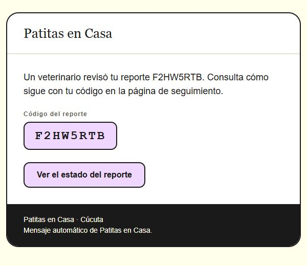
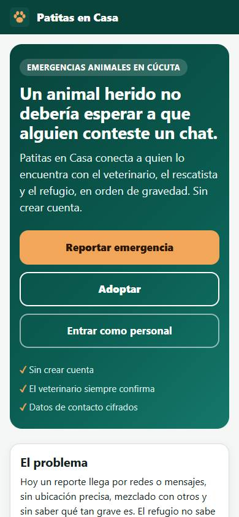
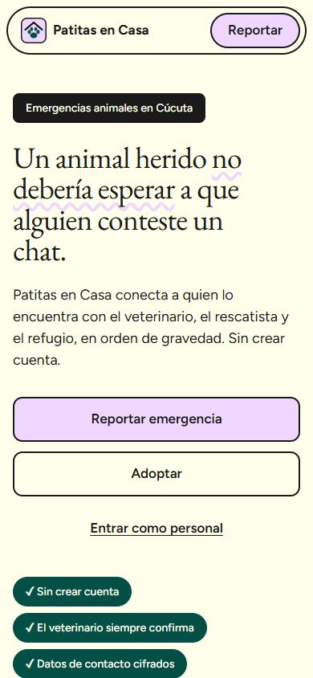
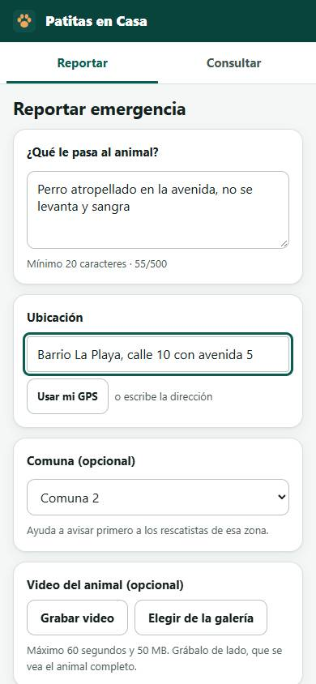
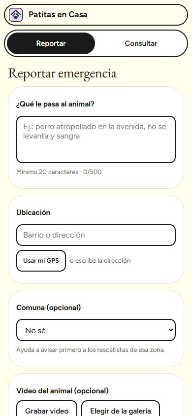
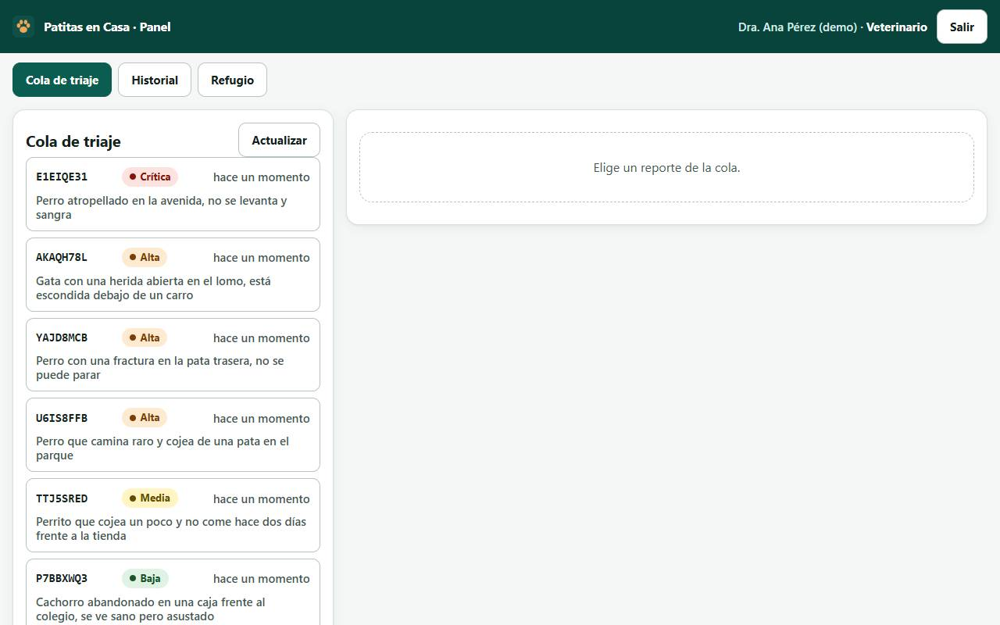
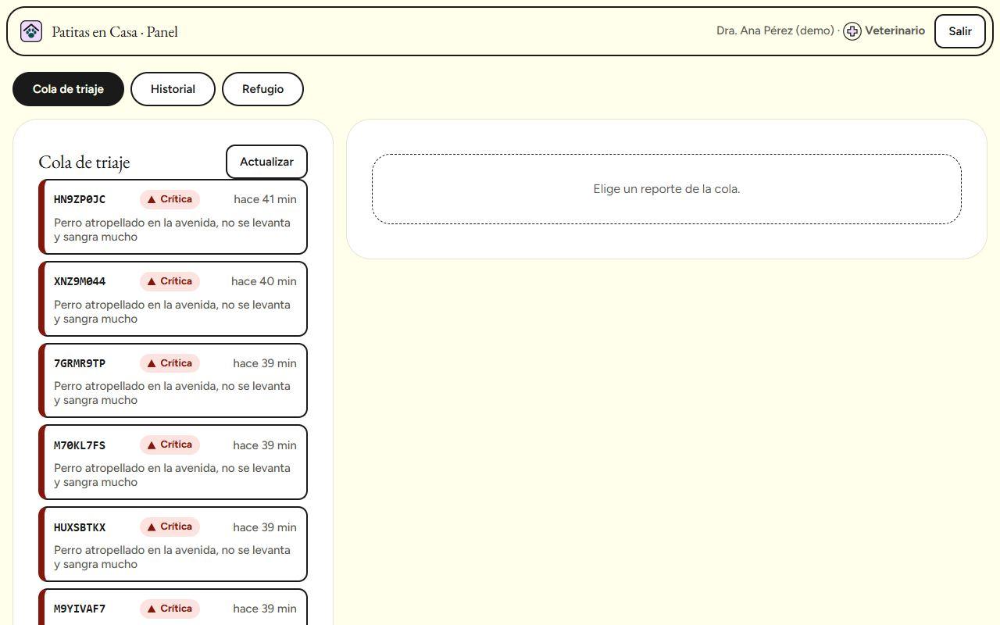
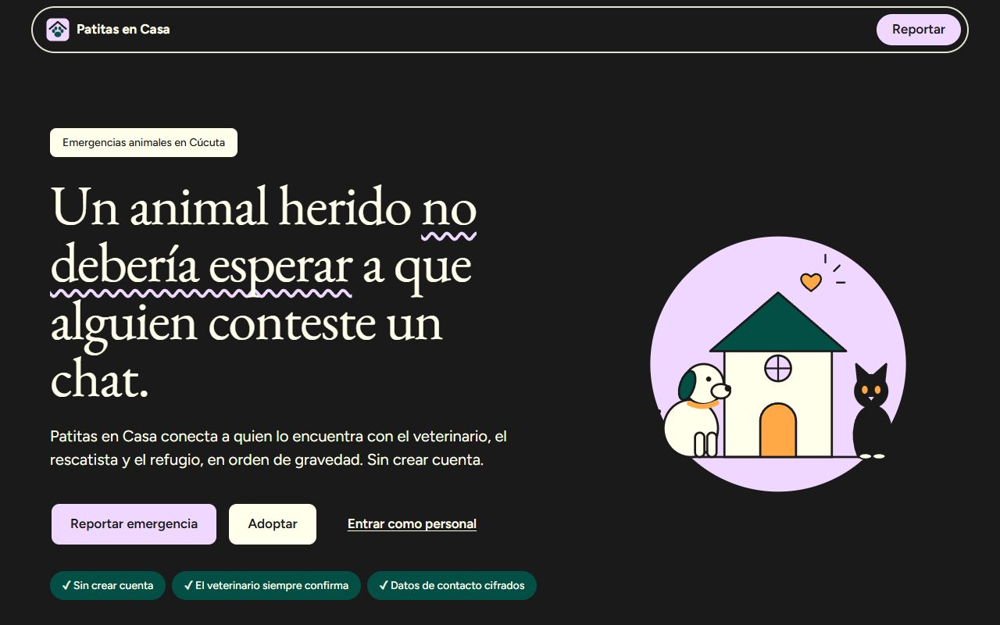

# Guía de estilo — Patitas en Casa

Sistema visual del rediseño de noviembre de 2026 (#293 a #310). Todos los valores salen del
código; si esta guía y el código no coinciden, manda el código y se corrige la guía.

| Archivo | Qué define |
|---------|-----------|
| `app/diseno/sistema.css` | Tokens (primitivos `--pc-*` y semánticos `--ds-*`) y componentes `ds-*` compartidos por inicio, PWA y panel |
| `app/diseno/fuentes.css` y `app/diseno/fuentes/` | EB Garamond y Figtree locales con su licencia |
| `app/inicio/inicio.css`, `app/pwa/estilos.css`, `panel/src/estilos.css` | Solo lo propio de cada pantalla, siempre con tokens (el panel no tiene ni un color fijo: lo prueba `tests/test_diseno.py`) |
| `app/notificaciones/plantilla.py` | Correos HTML |
| `app/diseno/roles/`, `app/diseno/ilustraciones/`, `app/pwa/icono.svg` | Ilustraciones SVG propias |

La referencia de estilo es `DESIGN.md` (editorial: lienzo crema, tinta casi negra, bordes de
2 px y radios grandes). Se toma su lenguaje visual, nunca su nombre, logo ni textos.

## 1. Paleta

Tres capas: **primitivos** (`--pc-*`, los únicos con hexadecimales de la marca) → **semánticos**
(`--ds-*`, los nombres de siempre, que cambian entre claro y oscuro) → componentes.

| Primitivo | Valor | Para qué |
|-----------|-------|----------|
| `--pc-crema` | `#ffffeb` | Lienzo de todas las pantallas; texto sobre oscuro |
| `--pc-tinta` | `#1a1a1a` | Texto, bordes de 2 px, cámaras oscuras, pestaña actual |
| `--pc-lavanda` | `#f0d7ff` | **La** acción principal; fila elegida; código de seguimiento |
| `--pc-bosque` | `#034f46` | Enlaces en claro; insignias de confianza; tarjetas de rol |
| `--pc-ascua` | `#ffa946` | Acento: paso actual de la línea de tiempo, relato del ciudadano |
| `--pc-piedra` | `#e4e4d0` | Divisores; realce al pasar sobre un botón normal |
| `--pc-niebla` | `#5c5c54` | Texto suave (DESIGN.md pide `#8a8a80`, que da 3,44:1: no llega a AA) |
| `--pc-niebla-noche` | `#c4c4b4` | Texto suave en oscuro |
| `--pc-carbon`, `--pc-grafito`, `--pc-blanco` | `#222222`, `#3d3d38`, `#ffffff` | Tarjetas y divisores en oscuro; tarjetas en claro |

Las prioridades y los mensajes (`--ds-critica`, `--ds-alta`, `--ds-media`, `--ds-baja`,
`--ds-info`, `--ds-peligro`) conservan sus colores propios: no son de DESIGN.md, pero cada uno
ya pasaba AA y cambiarlos no aportaba nada a las reglas de negocio.

### Contraste medido

Calculado con la fórmula de WCAG 2.2 sobre los valores resueltos del CSS (la misma cuenta que
hace `tests/test_diseno.py::test_contraste_aa_en_claro_y_oscuro`, que falla si alguno baja).

| Par | Claro | Oscuro |
|-----|-------|--------|
| Texto sobre el lienzo (`--ds-tinta` / `--ds-fondo`) | 17,20:1 | 17,20:1 |
| Texto sobre tarjeta (`--ds-tinta` / `--ds-superficie`) | 17,40:1 | 15,72:1 |
| Texto suave sobre el lienzo | 6,67:1 | 9,86:1 |
| Texto suave sobre la fila elegida (`--ds-marca-tenue`) | 5,10:1 | 5,38:1 |
| Enlace sobre el lienzo (`--ds-marca`) | 9,39:1 | 13,15:1 |
| Botón principal (tinta sobre lavanda) | 13,15:1 | 13,15:1 |
| Botón al pasar encima (`--ds-realce`) | 13,51:1 | 10,79:1 |
| Insignia crítica / alta / media / baja / info | 8,08 / 7,04 / 7,29 / 7,65 / 7,81:1 | 8,66 / 8,39 / 8,88 / 8,76 / 8,14:1 |
| Botón de peligro | 7,82:1 | 9,32:1 |
| Borde de los campos (no texto: mínimo 3:1) | 17,40:1 | 12,35:1 |

El texto suave se oscureció dos veces: `#66665c` pasaba sobre crema (5,7:1) pero axe-core lo
marcó sobre la fila elegida de la cola (lavanda, 4,38:1); quedó `#5c5c54` (#297).

## 2. Tipografía

| Familia | Uso | Archivo |
|---------|-----|---------|
| **EB Garamond** 400 | `h1` y `h2`, cifras clave, nombre del animal, relato del ciudadano, marca | `eb-garamond-latin-400-normal.woff2` |
| **Figtree** variable 300–900 | Todo lo demás; botones y etiquetas en 600 | `figtree-latin-wght-normal.woff2` |

- Servidas por el propio servidor (`/diseno/fuentes/`, 44 KB en total, subconjunto latino con
  á é í ó ú ñ ü ¿ ¡ « »), licencia SIL OFL 1.1 junto a cada archivo y `font-display: swap`. La CSP
  (`default-src 'self'`) no cambia y la IP del ciudadano no llega a ningún tercero.
- La PWA guarda las dos fuentes en su service worker (`patitas-pwa-v9`): abre sin señal con ellas.
- Respaldo: Georgia para la serif y `system-ui` para la sans.

| Elemento | Tamaño |
|----------|--------|
| Título de la portada | `clamp(2.25rem, 1.25rem + 4.5vw, 4.5rem)`: 36 px a 360 px, 72 px en escritorio |
| `h2` de la portada | `clamp(1.75rem, 1.2rem + 2.5vw, 3rem)` |
| `h1` de la PWA | `clamp(1.75rem, 1.4rem + 1.5vw, 2.25rem)` |
| `h1` / `h2` del sistema | 2rem / 1.5rem |
| Cifra clave (Indicadores, piloto) | 2.75rem |
| Texto | 1rem con interlineado 1,5 (1.0625rem en la portada) |
| Escala `--ds-t-*` | xs .8125 · sm .9375 · md 1 · lg 1.25 · xl 1.75 rem |

## 3. Espacios y radios

- Escala de espacios `--ds-e1` a `--ds-e6`: 4, 8, 12, 16, 24, 32 px. Secciones de la portada
  separadas 32 px en el celular y 64 px desde 720 px.
- Tarjetas: relleno 24/16 px en el celular y 32 px desde 720 px.

| Radio | Valor | Dónde |
|-------|-------|-------|
| `--ds-radio` | 12 px | Botones y campos |
| `--ds-radio-lg` | 24 px | Recuadros de ajuste, ofertas, código, estados vacíos |
| `--pc-radio-tarjeta` | 32 px | Tarjetas |
| `--pc-radio-camara` | 40 px (64 px en escritorio) | Cámaras oscuras de la portada |
| `--pc-radio-pildora` | 9999 px | Cabeceras, pestañas, insignias |

Sin sombras (`--ds-sombra: none`) ni degradados: se separa con el borde y el cambio de fondo.

## 4. Componentes

- **Botones** (`ds-btn` o `<button>`): 44 px de alto como mínimo, borde de 2 px
  `--ds-linea-fuerte`, Figtree 600. **Principal** (`ds-btn--pri`, `button.principal`): lavanda con
  texto en tinta; al pasar encima se invierte. **Peligro** (`ds-btn--peligro`): descartar.
  **Grande**: 56 px (enviar reporte). Al pasar encima, un botón normal usa `--ds-realce` (piedra),
  para no confundirse con la acción principal.
- **Campos**: borde de 2 px, radio 12, 44 px de alto; la etiqueta completa es el objetivo táctil
  de las casillas. El botón nativo «Elegir archivo» tiene la misma forma (`::file-selector-button`).
- **Cabeceras**: píldora flotante con borde de 2 px (inicio y PWA); en el panel, en el celular,
  la cuenta baja a su propia línea.
- **Pestañas**: píldoras; la actual con **fondo invertido** (tinta/crema) además de
  `aria-current`. En la PWA forman un control segmentado.
- **Insignias de prioridad**: texto + color + **forma** (WCAG 1.4.1):

  | Prioridad | Forma | En la cola y en las ofertas |
  |-----------|-------|-----------------------------|
  | Crítica | ▲ triángulo | barra lateral de 8 px |
  | Alta | ◆ rombo | barra lateral de 4 px |
  | Media | ● círculo | borde normal |
  | Baja | ○ anillo | borde normal |

- **Fila elegida** de la cola: invertida (como la pestaña actual) y `aria-pressed`.
- **Tablas**: en el celular (≤ 600 px) cada fila es una tarjeta con la etiqueta de cada dato
  (`ds-tabla--tarjetas` + `data-etiqueta`); lo exige una prueba de Vitest para toda tabla.
- **Cifras clave** (`.kpi`): número en serif grande; la primera, invertida.
- **Estados vacíos** (`ds-vacio`): borde punteado, texto que explica qué falta e ilustración.
- **Mensajes** (`ds-msg--error|ok|aviso|info`): color de su estado, borde izquierdo de 4 px y texto.

## 5. Correos

`app/notificaciones/plantilla.py` arma el HTML desde el mismo texto del aviso (no agrega datos,
RN-14; todo con `html.escape`). Tablas y estilos en línea, 600 px máximo, Georgia en la marca y
Arial en el texto, sin CSS ni fuentes externas, sin JavaScript ni imágenes (ni píxeles de
rastreo). Cabecera con la marca, mensaje, código destacado en lavanda, botón (seguimiento para el
ciudadano, panel para el personal) y pie oscuro «Patitas en Casa · Cúcuta». Sale como
`multipart/alternative` con el texto plano de siempre.

## 6. Ilustraciones

SVG hechos para el proyecto con la paleta (ninguno descargado): ícono de la app (huella bajo un
techo), siete íconos por rol, la portada (perro y gato frente al refugio) y dos estados vacíos.
Solo atributos de presentación: sin `<style>`, `<script>` ni recursos externos (así pasan la CSP y
se ven igual sobre claro u oscuro). Son decorativas: `alt=""`. `tests/test_ilustraciones.py`
revisa que sean XML válido, seguro, con la paleta y que se usen.

## 7. Accesibilidad (WCAG 2.2 AA)

1. Contraste de texto ≥ 4,5:1 y de bordes de campos ≥ 3:1, en claro y oscuro (medido por prueba).
2. Objetivos táctiles de 44 px como mínimo; 56 px en las acciones de la portada y de la PWA.
3. Foco visible de 3 px (`:focus-visible`) en todo; la cabecera fija deja `scroll-padding-top`
   para no taparlo.
4. Nada se comunica solo con color: prioridades con forma y barra; pestañas, comunas y fila
   elegida con fondo invertido o ✓.
5. Sin desplazamiento horizontal a 320 px; tablas como tarjetas en el celular.
6. `prefers-reduced-motion` apaga las transiciones.
7. axe-core con las etiquetas de `scripts/accesibilidad/revisar.mjs` (WCAG 2.2 AA y buenas
   prácticas) en las pantallas públicas y las de los seis roles, a 360, 768 y 1440 px, claro y
   oscuro: sin fallas en cada PR del rediseño (#294 a #310).

## 8. Antes y después

| Antes | Después |
|-------|---------|
|  |  |
|  |  |
|  |  |

Modo oscuro de la portada (las cámaras pasan a verde bosque):

